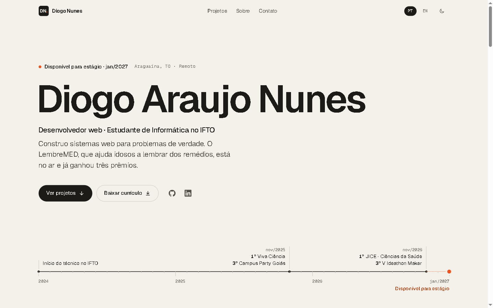

# diogonuness.github.io

Site pessoal de **Diogo Araujo Nunes**, desenvolvedor web e estudante de Informática no IFTO.
Reúne os projetos (LembreMED e Norma Clara), os prêmios e o contato, em português e em inglês.

**No ar:** <https://diogonuness.github.io>



## Stack

- **HTML, CSS e JavaScript puros.** Sem framework, sem build e sem dependências: o que está no repositório é exatamente o que o navegador recebe.
- **Fontes:** [Geist e Geist Mono](https://github.com/vercel/geist-font) (licença OFL), servidas do próprio site.
- **Ícones:** logotipos oficiais do [Devicon](https://devicon.dev) e do [Simple Icons](https://simpleicons.org), em SVG local.
- **Hospedagem:** GitHub Pages, publicando a branch `main` a partir da raiz.

Lighthouse (20/11/2026, servidor local): **celular 99 · 100 · 100 · 100** e **desktop 100 · 100 · 100 · 100**
(desempenho, acessibilidade, boas práticas e SEO).

## Como rodar localmente

O site precisa ser aberto por um servidor (`http://`), não direto do disco (`file://`). Qualquer uma destas opções serve:

```bash
# com Python
python -m http.server 8000

# ou com Node.js
npx serve .
```

Depois abra <http://localhost:8000>. No VS Code, a extensão **Live Server** também funciona.

## Estrutura

```text
index.html          a página inteira, comentada por seção
404.html            página de "não encontrado"
css/style.css       todos os estilos, em blocos numerados (01. Fontes, 02. Tokens...)
js/main.js          idioma, tema, menu do celular, régua e botão de copiar
assets/fonts/       Geist e Geist Mono (.woff2) + licença OFL
assets/icons/       logotipos oficiais da stack (.svg)
assets/img/         imagens do site
og.png              imagem que aparece ao compartilhar o link (1200 × 630)
favicon.svg/.ico    monograma "DN"
sitemap.xml         robots.txt
```

## Como editar

- **Textos em português:** direto no `index.html`.
- **Textos em inglês:** no objeto `textosEn`, no começo do `js/main.js`. Cada texto tem uma chave igual ao atributo `data-i18n` do HTML.
- **Cores, fontes e espaçamentos:** no bloco `02. Tokens` do `css/style.css`. Mudou lá, muda no site todo, nos dois temas.
- **Régua da trajetória (hero):** cada marco tem `--m`, o número do mês contado a partir de jan/2024 (jan/2024 = 0, jan/2027 = 36).
- **O que falta preencher:** procure por `TROCAR` no `index.html`. Cada comentário diz o que colocar e já traz o `` pronto para colar.

## Créditos

Geist © The Geist Project Authors (SIL Open Font License 1.1). Ícones do Devicon (MIT) e do Simple Icons (CC0).
Os logotipos são marcas dos respectivos donos.
